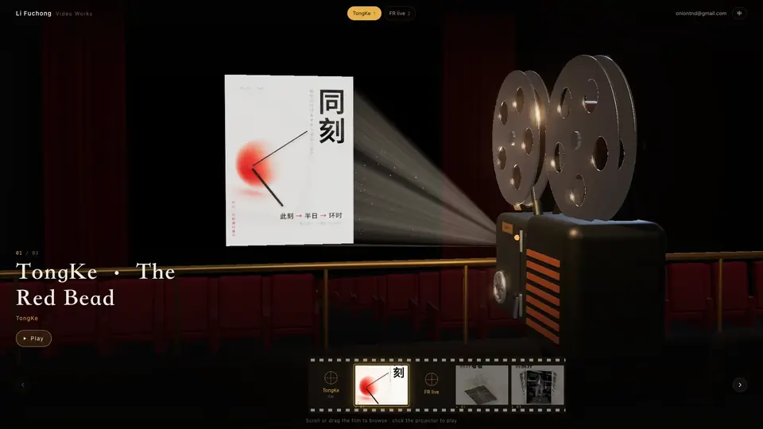

# Screening Room · 放映厅

**中文** · [English](README.en.md)

把你的视频作品集做成一间 3D 放映厅：镜头在放映间里越过放映机看向银幕，点一下放映机——灯亮、片盘转、走过 3-2-1 片头，镜头沿着光束飞到银幕前，影片直接投在银幕上播放。

[](docs/preview.mp4)

<sub>点图看 1080p · 60 帧高清视频（有声）</sub>

**在线演示：** https://onion0619.github.io/screening-room/ （[English](https://onion0619.github.io/screening-room/en/)）

- **mp4 真的投在银幕上**：画面是 3D 银幕上的贴图，光束形状跟着画幅走，银幕反光随画面变色照亮观众席
- **也支持平台视频**：YouTube、B 站、Vimeo、TikTok、新片场用各自的官方播放器；抖音等不能嵌入的平台显示封面 + 跳转观看
- **只改一个文件**：`reel.config.json` 填名字、分类和视频链接；封面可选，不填就自动截帧或取平台封面
- **中英双语**：页面一键切换，另有 `/en/` 英文页，分享到 X 时有英文预览卡片
- **手机可用**：左右滑动换片，性能不够时自动降分辨率
- **纯静态**：构建出来就是一个文件夹，GitHub Pages / Cloudflare / Vercel / Netlify 都能放

## 三步用起来

1. 点仓库右上角 **Use this template → Create a new repository**，复制一份到你的账号。
2. 改 `reel.config.json`，把视频放进 `public/media/`（或者直接填平台链接），提交。
3. 仓库 **Settings → Pages → Source** 选 **GitHub Actions**。之后每次推送都会自动发布，地址是 `https://<你的用户名>.github.io/<仓库名>/`。

## 配置

```jsonc
{
  "site": {
    "name": { "zh": "李复冲", "en": "Li Fuchong" },  // 文字都可以写成字符串，或按语言分开写
    "tagline": { "zh": "影像作品", "en": "Video Works" },
    "description": { "zh": "…", "en": "…" },        // 搜索和分享卡片用
    "contact": "you@example.com",                    // 邮箱或链接，可不填
    "url": "",                                       // 站点地址；用 GitHub Pages 时自动填
    "languages": ["zh", "en"],                       // 只要一种语言就写一个
    "defaultLang": "zh",                             // 放在 / 的语言，其它语言在 /en/ 这样的路径
    "shareImage": "media/cover.jpg"                  // 分享卡片的图，1200×630 最佳
  },
  "categories": [
    { "id": "ads", "name": { "zh": "广告", "en": "Commercials" } }
  ],
  "videos": [
    {
      "id": "my-film",                               // 可选，分享链接用：/#my-film
      "title": { "zh": "片名", "en": "Title" },      // 平台视频可不填，会自动取
      "category": "ads",
      "src": "media/my-film.mp4",                    // 见下表
      "cover": "media/my-film.jpg",                  // 可选
      "aspect": "9:16"                               // 可选，mp4 会自动识别
    }
  ]
}
```

编辑器里打开 `reel.config.json` 会有自动补全和校验（`reel.schema.json`）。

### `src` 可以填什么

| 来源 | 写法 | 播放方式 | 说明 |
| --- | --- | --- | --- |
| 本地 mp4 | `media/film.mp4`（放在 `public/` 下） | **直接投在 3D 银幕上** | 推荐。封面不填会自动截第 1 秒 |
| 远程 mp4 | `https://…/film.mp4` | 投在银幕上 | 视频服务器需要允许跨域（CORS），否则读不到画面 |
| YouTube | `https://www.youtube.com/watch?v=…` / `youtu.be/…` / `/shorts/…` | 官方播放器 | 自动取标题和封面；中国大陆打不开 |
| B 站 | `https://www.bilibili.com/video/BV…` | 官方外链播放器 | 自动取标题和封面；外链播放器画质偏低 |
| Vimeo | `https://vimeo.com/…` | 官方播放器 | 自动取标题和封面 |
| TikTok | `https://www.tiktok.com/@…/video/…` | 官方嵌入播放器 | 自动取标题和封面 |
| 新片场 | `https://www.xinpianchang.com/a…` | 官方播放器 | 自动取播放器参数和封面 |
| 抖音 | `https://www.douyin.com/video/…` | 封面 + 跳转观看 | 没有公开的嵌入方式，**需要自己填封面** |

**给中英文观众不同的来源：** `"src": { "zh": "https://www.bilibili.com/video/BV…", "en": "https://youtu.be/…" }`

**关于平台反爬：** 本模板只嵌入各平台官方提供的播放器，不解析、不下载视频本身。标题和封面只在构建时通过官方接口（oEmbed 等）取一次，存进 `.cache/` 和站点里，访客打开网页时不会请求这些接口。

## mp4 建议

- 视频只在点放映时才开始加载，不会拖慢首屏；但请先压缩，并把文件头放到前面，这样能边下边播：

  ```bash
  ffmpeg -i in.mp4 -c:v libx264 -crf 23 -maxrate 5M -bufsize 10M -pix_fmt yuv420p -movflags +faststart -c:a aac -b:a 128k out.mp4
  ```

- 适合短片、样片。几分钟以上的长片建议用平台播放器，它们会按网速自动调清晰度。
- 单个文件的上限：GitHub 100 MB，Cloudflare 25 MB。更大的文件放到对象存储（如 Cloudflare R2），`src` 写完整网址并开启 CORS。

## 部署

| 平台 | 做法 |
| --- | --- |
| GitHub Pages | 已带 `.github/workflows/pages.yml`，按上面“三步”开启即可 |
| Cloudflare | `npx wrangler login`，然后 `npm run deploy:cloudflare`；自定义域名见 `wrangler.jsonc` |
| Vercel / Netlify | 导入仓库即可，已带 `vercel.json` / `netlify.toml`（构建命令 `npm run build`，输出 `dist`） |

装了 ffmpeg 的话，构建时会自动截封面、生成胶片小图；没装也能构建，封面改在浏览器里截帧。

## 本地开发

```bash
npm install
npm run dev        # 构建并打开 http://localhost:5173
```

改了配置或代码后重新运行 `npm run dev`。试别的配置：`REEL_CONFIG=examples/mixed-sources.json npm run dev`。

### 给你的放映厅录一段宣传短片

```bash
npx playwright install chromium   # 第一次需要
npm run build && npm run record
```

逐帧渲染出 `docs/preview.mp4`（1920×1080、60 帧、混入原片声音）和 README 用的 `docs/preview.webp`，适合直接发社交平台。竖版：`node scripts/record.mjs --size=1080x1920 --out=docs/preview-vertical.mp4`；其它参数见 `scripts/record.mjs` 开头。需要装 ffmpeg。

| 文件 | 作用 |
| --- | --- |
| `reel.config.json` | 唯一需要改的内容配置 |
| `src/scene.js` | three.js 放映厅：放映机模型、体积光束与灰尘、银幕、观众席、镜头推进 |
| `src/app.js` | 换片、放映、播放控制、语言切换、手势 |
| `src/i18n.js` | 界面文字（中 / 英） |
| `src/style.css` | 叠在 3D 画面上的界面 |
| `scripts/build.mjs` | 读配置 → 识别来源 → 封面 → 生成各语言页面 → 打包 |
| `scripts/record.mjs` | 逐帧录制宣传短片（`npm run record`） |

## 常见问题

**手机上点放映后没声音？** 有些浏览器不允许自动有声播放，这时会静音开始并出现“点这里打开声音”。

**分享到 X 没有大图？** 填 `site.url`（GitHub Pages 会自动填），并把 `shareImage` 换成 1200×630 的图。

**页面在不支持 WebGL 的设备上？** 会退回平面模式：封面铺底，视频居中播放。

## 授权

代码以 [MIT](LICENSE) 授权，可以随意使用和修改。

`public/media/` 里的演示视频和封面是作者李复冲的作品（同刻 TongKe 与 FR live 两款 App 的宣传片），**不在 MIT 授权范围内**，用作你自己的站点时请换成你的作品。
